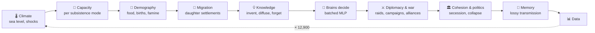
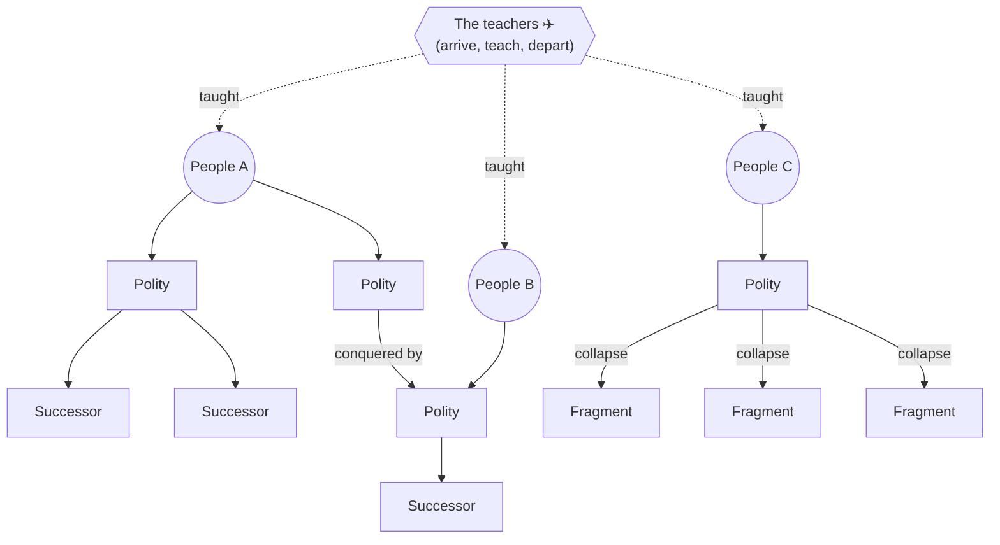

<div align="center">

```
 ██████╗ ███████╗██╗     ██╗   ██╗ ██████╗ ███████╗
 ██╔══██╗██╔════╝██║     ██║   ██║██╔════╝ ██╔════╝
 ██║  ██║█████╗  ██║     ██║   ██║██║  ███╗█████╗
 ██║  ██║██╔══╝  ██║     ██║   ██║██║   ██║██╔══╝
 ██████╔╝███████╗███████╗╚██████╔╝╚██████╔╝███████╗
 ╚═════╝ ╚══════╝╚══════╝ ╚═════╝  ╚═════╝ ╚══════╝
   ~≈~≈~≈~≈~≈~≈~≈~≈~≈~≈~≈~≈~≈~≈~≈~≈~≈~≈~≈~≈~≈~≈~≈~
```

### 12,900 years of history after the flood, and none of it is scripted.

*A civilization sim driven by neuroevolution. Peoples rise, split, conquer, forget,
and form their own founding memories. The code supplies only the physics.*


</div>

---

## 🌊 The premise

A global nuclear war melted the ice caps. The seas rose. **One thousand years later**, the survivors
are scattered hunter-gatherer bands on a drowned world.

That's year 0. The sim then runs **12,900 years, one step per year**, up to the present day.

| | Who | Starting state |
|---|---|---|
| 🏕️ | **Five forager peoples (A to E)** | Bands of 100 to 250 people, foraging only, each with a random culture and a random brain |
| ✈️ | **The teachers** | 30 to 60 humans with knowledge from before the catastrophe. They arrive, teach, interact with the five peoples for a while, then **leave by air for good** |

What the peoples do with that knowledge (keep it, spread it, lose it, fight over it) and what they
*remember* of the visitors is entirely up to the simulation.

> **Industry is possible, never guaranteed.** Steam, electricity and oil sit at the end of the
> knowledge graph. Whether anyone gets there by year 12,900 is an outcome of the run.

---

## 🧬 Design principles

- **Emergence over scripting.** The code supplies mechanisms, never content. If states rise on
  rivers or certain events dominate memory, that has to *emerge*.
- **No LLM agents.** Every decision comes from small neural networks evolved inside the sim. It runs
  offline on a CPU and costs zero tokens.
- **Groups, not individuals.** Agents are settlements and polities. People are numbers inside them.
- **Deterministic per seed.** Same seed + same config = identical history.
- **No fitness function.** Selection *is* the sim. A brain spreads when its polity grows and splits,
  and dies when the polity is conquered or collapses.

---

## ⏳ One year in the life of the world



---

## 🗺️ What's inside

<table>
<tr>
<td width="50%" valign="top">

### 🌍 A world that floods
Procedural continents from simplex noise and tectonics, hydraulic erosion, rivers by flow
accumulation, Whittaker biomes, rain shadows. **Sea level rises 60 m over the first 3,000 years**,
so coastlines keep drowning. A Younger Dryas-style cold snap, a warm optimum, droughts and volcanic
winters. Copper, tin, iron, coal and oil deposits.

</td>
<td width="50%" valign="top">

### 🌾 Foragers, herders, farmers
Settlements grow toward carrying capacity, store surplus, starve in bad years and bud off daughter
settlements. Farming is sticky: fields and granaries make leaving costly.

</td>
</tr>
<tr>
<td valign="top">

### 💡 A knowledge graph
From **agriculture and calendars** to **bronze, writing and iron**, then **printing, gunpowder,
steam, railways, electricity and oil**. Techniques are invented, diffuse between neighbors, and are
**forgotten** when unused. Knowledge can die in a collapse.

</td>
<td valign="top">

### 🏛️ Polities & asabiya
Cohesion after Turchin's metaethnic frontier model, structural-demographic pressure after Turchin
and Goldstone. Big states overextend, lose cohesion and **break apart, with no scripted cycle**.

</td>
</tr>
<tr>
<td valign="top">

### 🧠 Evolving brains
~24 inputs → 16 tanh → 12 outputs, about 600 weights per polity, all evaluated in **one batched
matmul per year**. Weights mutate on splits and cross over on mergers. The five founding peoples
start with different temperaments.

</td>
<td valign="top">

### ⚔️ War & conquest
Strength from mobilized population × tech × cohesion × logistics. Terrain and fortifications favor
the defender. Conquered settlements keep their culture and hold a **grievance**, so conquest without
assimilation sets up later breakup.

</td>
</tr>
<tr>
<td valign="top">

### 🎭 Appearance & dialect
Heritable visible traits and a drifting dialect, **markers only, with no built-in effect on
anything**. Whether in-group preference evolves is left to selection, through brain weights that
start at zero.

</td>
<td valign="top">

### 📜 Emergent memory
Events become memories. Every generation they are **decayed, coarsened, merged, and credited to
other actors**. Symbols are plain integer handles. The code has **no story vocabulary at all**, and
a test enforces it. Every memory keeps its provenance chain back to what really happened.

</td>
</tr>
</table>

---

## 🌳 Descent is a tree

Every settlement and polity carries a lineage id and a parent id, so history can always be traced
back to the six founding groups:



---

## 🚀 Quickstart

```bash
# create a virtual environment and install
python -m venv .venv
.venv\Scripts\activate            # Windows  (source .venv/bin/activate elsewhere)
pip install -e .[dev]

# watch history unfold in the browser
solara run deluge/viz/app.py

# a headless 12,900-year run
python scripts/run.py --world-seed 1 --history-seed 42

# many histories in parallel
python scripts/batch.py --n-seeds 20 --batch-dir runs/batch_01

# tests (fast suite; add -m slow for the long ones)
pytest
```

All tunable numbers live in [`configs/`](configs/). The knowledge graph is plain data in
[`configs/knowledge.yaml`](configs/knowledge.yaml).

---

## 🔭 In the browser

- **Polity map:** every claimed cell in its founding people's hue, darker where more people live,
  with thick borders between peoples and thin ones between sibling polities
- **Layers:** terrain, population, subsistence, cohesion, technique spread, resources
- **Overlays:** capitals, monuments, the teachers' flight path, war arrows, alliance lines
- **Inspector:** click a polity to see its culture vector, brain outputs, allies and enemies, and its
  heaviest symbols with their provenance
- **Panels:** population per people over time, polity count, the lineage tree

---

## 📊 Questions the output can answer

- How often does each founding people end up largest, and what predicts it: start location, early
  contact with the teachers, or climate luck?
- When does farming spread, how fast, and from where?
- How long do polities last, and how big do they get?
- Which memories survive longest, and **who gets credited** in them over time?
- Does in-group preference by appearance or dialect evolve, and under what conditions?
- What do surviving brains converge on, compared with the founders' random ones?

Headless runs write Parquet tables (`model`, `lineages`, `polities`, `events`, memory snapshots,
brains) under `runs/`, and the scripts in [`analysis/`](analysis/) compare them across seeds.

---

## 🗂️ Layout

```
deluge/
├── configs/        every tunable number, the knowledge graph, world presets
├── deluge/
│   ├── world/      terrain, rivers, climate, sea level, capacity, minerals
│   ├── agents/     settlements, polities, lineages, the teachers
│   ├── systems/    one module per yearly phase
│   ├── brains/     batched MLP, features, inheritance & mutation
│   ├── data/       collectors and the global event log
│   └── viz/        Solara browser UI with a custom hex map
├── scripts/        run, batch, renderers, profiling
├── analysis/       memory, provenance and batch reports
├── tests/
└── docs/           the full build spec and API notes
```

The full design lives in **[`docs/SPECS.md`](docs/SPECS.md)**.

---

## 📚 Standing on the shoulders of

- Turchin et al., *War, space, and the evolution of Old World complex societies*, PNAS 2013
- Turchin, *War and Peace and War* (2006)
- Epstein & Axtell, *Growing Artificial Societies* (1996)
- Axelrod, *The Evolution of Cooperation* (1984); Hammond & Axelrod, *The Evolution of Ethnocentrism* (2006)
- Boyd & Richerson, *Culture and the Evolutionary Process* (1985)
- [Mesa](https://mesa.readthedocs.io/), agent-based modeling in Python

<div align="center">

```
~≈~≈~≈~≈~≈~≈~≈~≈~≈~≈~≈~≈~≈~≈~≈~≈~≈~≈~≈~≈~≈~≈~≈~≈~
      the waters rose. what came after is up to the seed.
~≈~≈~≈~≈~≈~≈~≈~≈~≈~≈~≈~≈~≈~≈~≈~≈~≈~≈~≈~≈~≈~≈~≈~≈~
```

</div>
